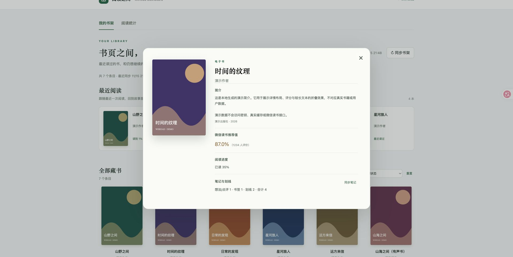
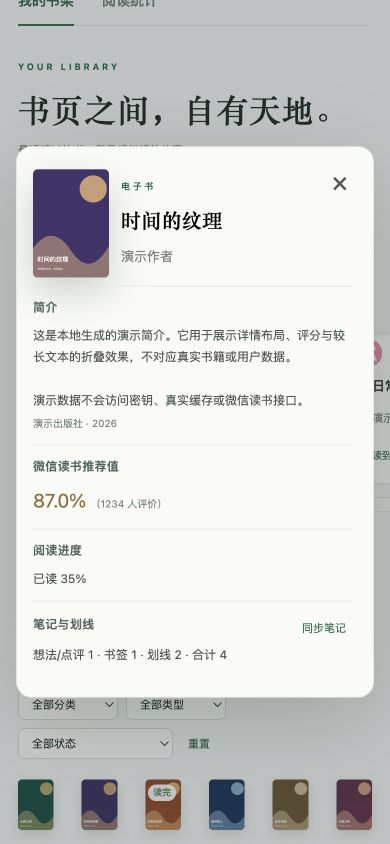

# 居中详情卡验收记录

日期：2026-11-15。状态：root 技术验收通过，等待用户体验验收。未推送、合并或部署。

后续用户发现加载中间态会因高度变化上跳；本记录的最终布局检查未覆盖这一问题。后续修复要求见 [加载稳定性修复](detail-stability.md)，以新验收记录为准。

## 分工与范围

root 编写 [设计需求](centered-detail.md)，两个独立的 gpt-6-luna agent 分别开发前端和补充测试；root 审查代码、提出修正并完成真实浏览器验收。本轮修改基线为 12bc811，沿用 feat/dynamic-bookshelf；后端 API 与缓存协议未变更。

桌面和手机均采用居中暖白详情卡，整卡 240ms 轻缩放淡入、160ms 淡出，遮罩随卡片淡出。移除封面 ghost / FLIP 和侧栏、底部抽屉动画。手机封面与标题并排；详情更新不重播入场。

## 自动化

root 在最终产品改动后亲自运行以下命令，全部退出成功：

```sh
python3 -m unittest discover -s tests -v  # 34 项通过
node --check web/app.js
node --check web/shelf.js
node tests/frontend.cjs
node tests/shelf_frontend.cjs
node tests/detail_motion.cjs
git diff --check
```

新增动画检查覆盖开闭时长、关闭完成后才释放 dialog、重复关闭、入场与遮罩动画取消、关闭中重开后的旧回调隔离、焦点与滚动恢复、Esc、reduced motion、无 WAAPI 回退；同时检查刷新不重播动画及部分请求失败保留已有内容，并确认强制刷新请求实际发起。测试 agent 在 VM 加载源码时分别临时移除动画替换的取消逻辑和刷新缓存回退逻辑，确认相应断言失败；恢复原源码后通过。未改动产品文件做变异测试。

CI 已加入新检查，但分支尚未推送，因此没有本轮远端 CI 结果。本机 Python 检查运行于 3.15；CI 配置的 3.11 / 3.13 尚待推送后验证。

## root 浏览器验收

使用真实 Chrome，未修改系统动画偏好。短屏长内容由临时演示服务生成虚构长书名、作者和多段简介，无真实账号数据；验收后该临时服务已停止。

| 场景 | 观察结果 |
| --- | --- |
| 桌面 1920×963 | 卡片宽约 850px，水平垂直居中；封面与文字同卡显示，背景书架仍清晰可辨 |
| 手机 390×844 | 卡片宽约 358px，左右各 16px，居中；封面与书名并排，无横向溢出 |
| 手机 390×560，长书名和简介 | 卡片高约 520px、上下各 20px；正文在卡片内滚动，关闭按钮保持可见；内部滚动后原页面位置不变 |
| 桌面 1000×540，长简介 | 卡片高 476px、上下各 32px；右栏 clientHeight 406px / scrollHeight 2924px，实际滚动成功，关闭按钮位置不变 |
| 关闭与返回 | 实测按钮、遮罩与 Esc；关闭后焦点回到原触发卡片，原页面滚动位置恢复 |
| 真实书架 | 真实封面加载成功，详情卡居中，内容与进度正常显示，无详情错误；不保存私人截图 |
| 减少动态效果与无 WAAPI | 由确定性生命周期测试和代码审阅验证；未声称做过系统设置切换实测 |

验收中发现并修复了桌面矮屏长简介被裁切，以及动画替换可能残留遮罩效果两处问题，修复后重新验收。

## 预览与截图

真实书架：http://127.0.0.1:8878 。演示书架：http://127.0.0.1:8877 。原服务继续保留，可刷新后点书体验；服务停止后分别用 `python3 dashboard.py --port 8878` 和 `python3 dashboard.py --demo --port 8877` 重启。





截图仅含虚构演示数据。当前任务分支尚不存在于远端；远端 main 经 git ls-remote 核对仍为 275b04b。用户明确验收通过后再执行合并。
