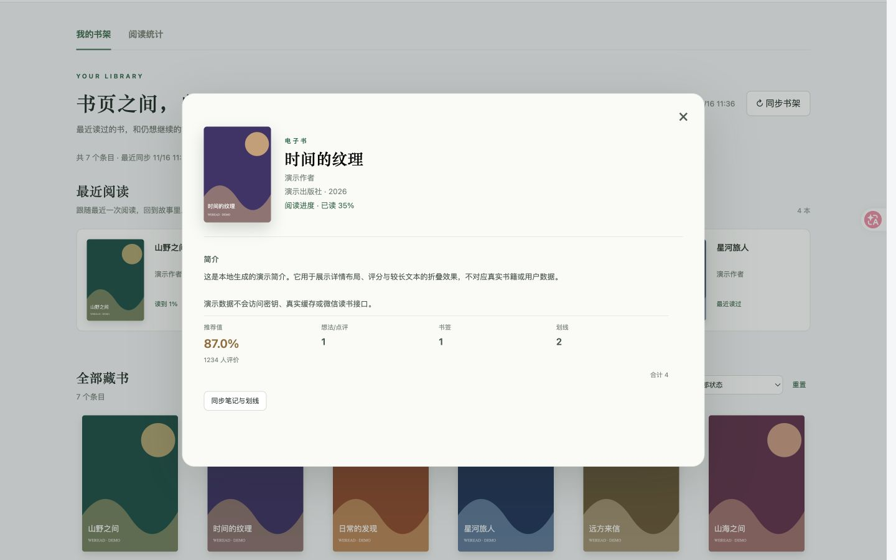
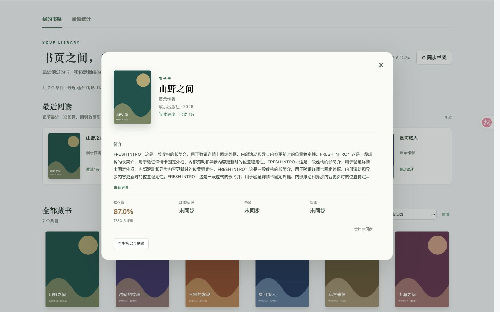
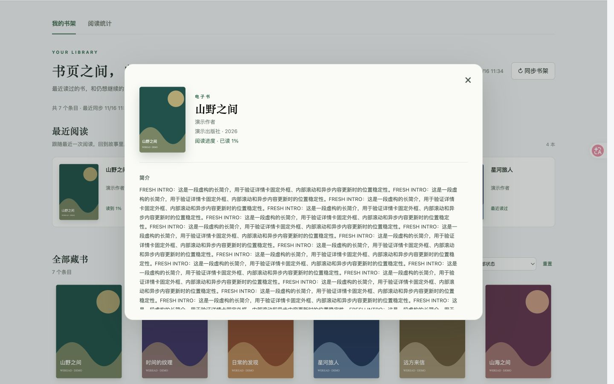
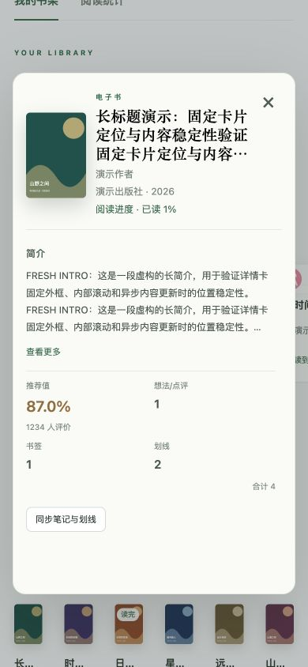

# 书籍详情概览验收

日期：2026-11-16。基线 144aead，分支 feat/dynamic-bookshelf。实现与本地技术验收完成，等待用户体验验收；未推送、合并或部署。

## 最终行为

封面缩小并与书名、作者、出版信息和阅读进度一起放在顶部。简介使用全宽，默认四行并显示省略号，只有实际溢出才出现“查看更多”。点击后原地展开全文，将统计和操作自然推下去；收起保留按钮焦点。推荐值、想法/点评、书签、划线与总数保留独立含义，笔记同步、错误重试和安全阅读链接保留。

桌面外框 840×600px，手机 358×660px，受视口可用高度约束。桌面身份区固定 200px、手机 180px，避免异步出版信息撑高顶部；长书名最多三行，作者和出版信息一行，完整文本仍保留在 DOM 与 title 中。只有正文区域滚动，背景滚动条空间继续保留。

源书卡提供 90ms 轻反馈，背景立即淡入 220ms，面板延迟 40ms 后以 .985→1 微缩放和淡入进入，历时 320ms；次要正文延迟 100ms 淡入，历时 200ms。面板无 translate；关闭 180ms。异步数据更新不重播入场，关闭取消未完成动画，快速重开保留旧 completion 隔离。减少动态效果与无 WAAPI 的行为由离线检查覆盖。

## root 视觉与测量

root 亲自在 Chrome 查看正常速度和三倍慢放，并检查长/短简介、加载占位到缓存再到刷新、展开与滚动、收起、长书名、手机、短屏和关闭恢复。截图只含虚构演示数据。测量摘要见 [JSON 证据](detail-overview-evidence.json)。

| 场景 | 正文可见高度 / 内容高度 | 结果 |
| --- | --- | --- |
| 基线 144aead，长简介，1440×900 | 550 / 1203px | 默认即滚动，笔记按钮在可视区下方 |
| 新版，16px 页面滚动条，长简介默认 | 326 / 326px | 无内部滚动，四行摘要、统计和同步操作完整可见 |
| 同上，展开简介 | 326 / 779px | 保留 scrollTop=0，从正文开头阅读，下面区块被推下 |
| 新版，桌面三行长书名 | 326 / 326px | 阅读进度 bottom=372.04px，位于身份区 bottom=381px 内 |
| 新版，390×844，长书名和长简介默认 | 434 / 434px | 无内部滚动，无页面横向溢出 |
| 同上，展开并滚轮阅读 | 434 / 1585px | 正文 scrollTop=844，背景 pageY=103.5 不变 |
| 同上，收起 | 434 / 434px | 回到 scrollTop=0，焦点留在 intro-toggle |
| 新版，390×560 短屏 | 294 / 376px | 允许正文滚动，同步操作可达，外框上下各留20px |
| 普通演示短简介，1440×900 | 326 / 326px | 不出现“查看更多”，统计与操作完整可见 |

最终有宽度滚动条场景共155个打开期间采样帧，覆盖 loading、cached-data、fresh-data。外框布局宽高始终840×600，中心漂移小于0.001px。打开前、打开期间、关闭后 body 宽度1424px、main 左边缘122px、背景 pageY=74 均不变。

普通演示还实测了“手机展开 → 桌面变宽至无需折叠 → 手机再次变窄”，按钮和折叠状态正确恢复。按钮、Esc、遮罩关闭均检查；手机遮罩关闭后焦点回到 book:demo1，pageY=103.5 保留。classic16 和 zero-width 是诊断页 CSS 环境，未修改操作系统滚动条或动画设置。

## 验证

- Python 单元与 HTTP 检查34项通过。
- app.js / shelf.js 语法检查，frontend、shelf_frontend、detail_motion 三份前端检查通过。
- 诊断服务编译和 diff 检查通过；未推送，因此远端CI未运行。
- 独立测试覆盖实际溢出判定、aria、无额外请求、刷新保展开与焦点、换书/重开重置、短文案无按钮、转义、动画取消、减少动态效果及无 WAAPI。
- 变异检查分别移除展开操作、刷新状态保持、短简介按钮隐藏、次要内容动画取消、ResizeObserver 稳定性和宽窄往返 class 同步，均能检出对应失败。

视觉验收发现并修复了两类自动化初始版本未覆盖的问题：重复溢出测量会将展开后的滚动拉回顶部；长标题顶部区域不足会遮住出版信息或让进度跨过分隔线。最终只观察稳定滚动容器的宽度变化，测量不临时折叠真实正文，并预留足够顶部高度；最终长简介默认无滚动已重新测量确认。

## 预览与复现

刷新真实书架 http://127.0.0.1:8878 或普通演示 http://127.0.0.1:8877 体验。普通服务保留；本轮临时诊断服务验收后停止。

```sh
# 桌面长简介，页面有16px宽滚动条，缓存与刷新异步返回
python3 tests/detail_visual_server.py --port 8777 --long-intro --classic-scrollbar --get-delay-ms 300 --sync-delay-ms 1500
# 同一基线对照：追加 --baseline-ref 144aead
# 手机长标题与长简介，三倍慢放，零宽滚动条模拟
python3 tests/detail_visual_server.py --port 8777 --long-intro --long-title --zero-scrollbar --slow-motion 3
```

每条命令独立运行。浏览器打开输出地址，点书后读取隐藏的 `#detail-visual-samples` 可取得外框、背景、简介、统计和正文滚动区域采样；展开/收起还会采样1.5秒。诊断服务不读取密钥、真实缓存或上游接口。









改版前的长简介布局：[对照截图](images/overview-baseline.jpg)。
