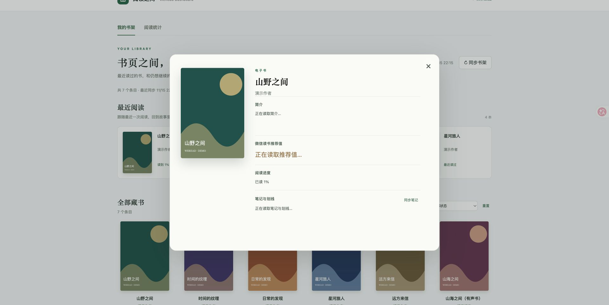
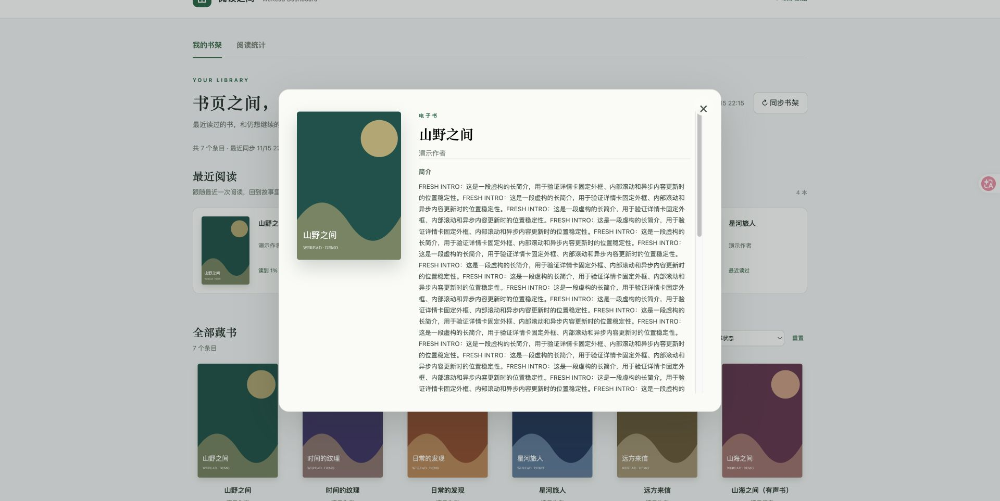
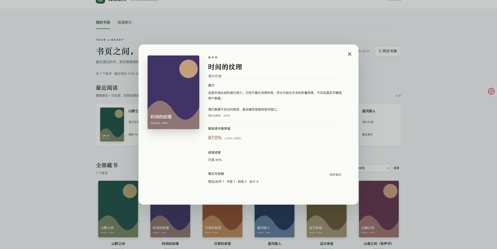
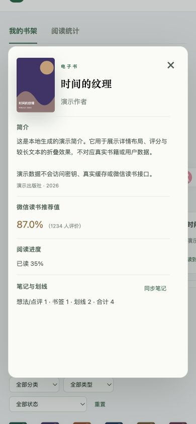

# 详情卡加载稳定性验收

日期：2026-11-15。基线 c05d550，任务分支 feat/dynamic-bookshelf。root 提需求、审查与视觉验收；两个 gpt-6-luna agent 分别开发和独立测试。实现完成，等待用户体验验收；未推送、合并或部署。

## 实现

外层网格负责居中，内层卡片使用固定响应式尺寸：桌面 min(620px, 视口高 - 64px)，手机 min(660px, 视口高 - 40px)。内容返回不再撑高外框。入场 300ms、ease-in-out、scale .99→1；关闭 180ms，无位移。简介占位预留三行，已有字段刷新时继续显示；正文滚动区预留滚动条空间。会话详情缓存按书 ID 使用，在成功替换书架时失效，并阻止失效前的请求重新填回。

## root 视觉与逐帧验收

root 使用真实 Chrome，亲自查看正常速度与三倍慢放下的入场中间帧、结束画面，以及加载占位、缓存返回和后台更新。诊断仅使用虚构数据，未修改系统动画偏好或安装浏览器依赖。

同一探针先运行固定基线 c05d550：1920×907 下检出高度 516→604→843px，关闭按钮在入场结束后仍从约 208→165→45px 上移，确认探针能检出原问题。新版每次约采样 4 秒、98–105 帧；原始测量摘要见 [JSON 证据](detail-stability-evidence.json)。

| 视口 / 缓存 GET 与后台更新延迟 | 外框尺寸 | 加载期间结果 |
| --- | --- | --- |
| 1920×963 / 1500ms、300ms | 850×620 | loading、cached、fresh 三阶段均捕获；中心漂移 <0.001px，入场结束后关闭按钮 y=184.5px 不变 |
| 390×844 / 300ms、1500ms | 358×660 | 长书名与长简介三阶段稳定，中心漂移 <0.001px，关闭按钮 y=105px 不变 |
| 390×560 / 300ms、1500ms | 358×520 | 上下各 20px；长标题仍留下 196px 正文滚动区，关闭按钮 y=33px 不变 |
| 1000×540 / 0ms、0ms | 850×476 | 首次加载与快速更新均稳定；关闭按钮 y=45px 不变 |

正常缩放期间边缘会有约 1% 的预期变化；上表检查不受缩放影响的布局宽高与中心，并在入场结束后比较关闭按钮。0ms 返回速度较快，采样捕获了 loading 与 fresh，未单独捕获 cached 帧；其他延迟场景覆盖完整三个阶段。

root 另实测：

- 手机与桌面长正文可内部滚动（手机 scrollTop=844、桌面 scrollTop=540），背景页面与关闭按钮不随之移动，无页面横向溢出。
- 故意让首次详情同步返回 503：已有简介、推荐值与进度保留，加载提示结束并出现重试；重试后错误消失，外框仍为 850×620、中心 y=481.5px、opacity=1，无重新弹出。
- 遮罩、按钮、Esc 均可关闭。Esc 关闭后焦点回到原书卡片，原 scrollY=42.5 保留。
- 真实书架缓存详情与封面正常，外框 850×620 且居中，无详情错误；未保存真实账号截图。
- reduced motion、无 WAAPI、关闭中重开与失效请求隔离由自动化验证，未声称进行了系统动画偏好切换或禁用浏览器 API 的实机验证。

## 自动化

最终产品修改后的本地检查：Python 34 项通过；app.js / shelf.js 语法检查及 frontend、shelf_frontend、detail_motion 三份前端检查通过；诊断服务编译与 diff 检查通过。CI 原有命令包含这些离线前端检查；本轮未推送，远端 CI 未运行。

测试 agent 使用 VM 源码变异，分别去掉缓存失效保护、缩短入场时长、引入 translate、替换平缓曲线，确认对应断言失败，恢复后通过。布局稳定性以真实浏览器采样验收，不靠假 DOM 的 CSS 字符串检查。

## 重现与预览

普通预览：真实书架 http://127.0.0.1:8878 ，演示书架 http://127.0.0.1:8877 。服务继续保留；刷新页面后体验。

诊断服务独立运行，退出后不影响普通应用：

```sh
python3 tests/detail_visual_server.py --port 8777 --get-delay-ms 1500 --sync-delay-ms 300 --long-intro
# 对照旧版：同样命令追加 --baseline-ref c05d550
# 手机长标题：追加 --long-title
# 目视慢放：追加 --slow-motion 3，打开终端输出的地址
# 失败重试：追加 --fail-sync-once；进度预热不消耗故意失败的次数
```

点击书卡片后的采样保存在页面隐藏的 #detail-visual-samples 文本中。后续探针已扩展为打开前、打开期间最多六秒、关闭后一点五秒，并将卡片字段放到 `card` 下，详见 [页面滚动条修复验收](viewport-scrollbar-fix.md)。测试服务不加载密钥、私有缓存或上游接口；本轮临时诊断服务已在验收后停止。

## 演示截图

同一视口加载前后：





正常内容的最终布局：





另存有 [入场末段画面](images/stable-detail-entry.jpg)。截图均为虚构演示数据。
