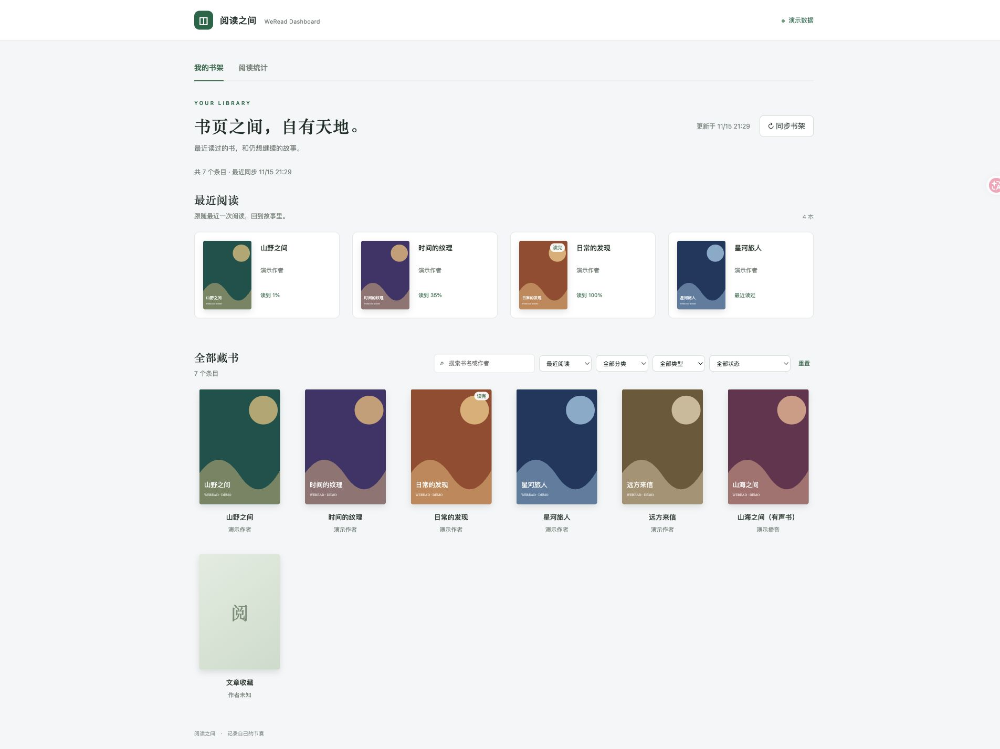
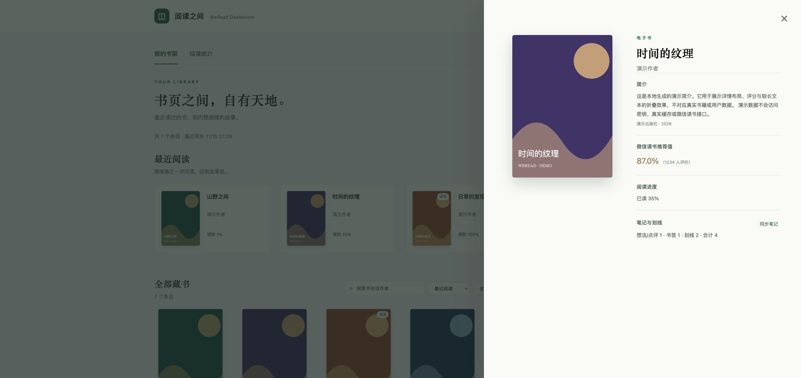
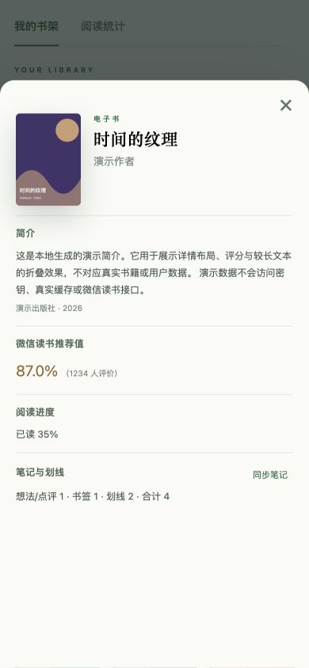

# 动态书架交付与验收记录

日期：2026-11-15。状态：实现及 root 技术验收完成，等待用户体验验收；不得合入 main。

本记录保留首版验收证据；其中侧栏、封面飞行动效与手机底部展开已由后续 [居中详情卡验收](centered-detail-acceptance.md) 替代。

## 分支与分工

- GitHub API 核对远端 main 和 feat/reading-dashboard 均指向 275b04b，原 dashboard 已在 main，无需重复合并。
- 从本地跟踪 origin/main 的 main 创建 feat/dynamic-bookshelf。
- root 编写需求和接口约定；三个 gpt-6-luna agent 分别完成后端、前端与独立测试。
- root 审查代码、反馈修正、完成集成收尾和真实 API / 浏览器验收。新功能尚未推送、合并或部署。

## 自动化验证

以下命令于最终产品改动后全部通过：

```sh
python3 -m unittest discover -s tests -v  # 34 项通过
node --check web/app.js
node --check web/shelf.js
node tests/frontend.cjs
node tests/shelf_frontend.cjs
git diff --check
```

覆盖：完整与合法空快照、失败保留、账号隔离、进度未知/1%/100%、推荐值换算、升级中止、笔记分页完整/缺字段/游标不前进/中断、详情分区失败保留、同本并发复用、同图跨书目下载复用、图片格式/体积/来源限制、首页正常导航与跨站 API 拒绝、演示隔离。

前端检查覆盖首次缓存读取后一次自动同步、排序和组合筛选不产生数据请求、localStorage 不可用、快速切换书籍不串内容、未知值不补零、非电子书不调用电子书详情接口、笔记标签与同步按钮、关闭回到触发卡片并禁止焦点引发滚动。

## root 实际验收

| 检查 | 结果 |
| --- | --- |
| 真实授权账号 | 完整书架、单书详情、进度、封面和完整笔记概览均成功同步，并可通过缓存 GET 读回；不在文档记录私人书目、计数或原始响应 |
| 缓存优先 | 浏览器显示完整旧书架时后台仍显示“正在同步”，不会等待上游才展示 |
| 桌面 | 封面墙、详情开闭、推荐值、笔记同步及继续阅读链接正常 |
| 手机 | 实际 390×844 视口验证；标题和按钮不挤压，最近阅读横向滚动，详情底部展开 |
| 本地筛选 | 文学分类与书名搜索组合得到目标演示条目，可重置 |
| 关闭行为 | 从完整书架打开后按 Esc，焦点回到 book-wall 中原书籍，保留原滚动位置 |
| 原统计 | 切换阅读统计后概览、图表和月份选择仍正常，统计同步与书架按钮分开 |
| 动效与无障碍 | 原生 dialog、Esc 与焦点返回实测；封面 ghost 开闭结构、减少动态效果的 CSS/JS 分支经代码审查。未修改用户系统动画偏好 |
| 截图 | 仅保存下方虚构演示截图；真实账号截图和缓存不提交 |

## 口径与限制

- 评分经公开微信读书详情页核对，原始 newRating=765 应显示推荐值 76.5%，不是 765 分。
- 单书累计时长字段存在说明与实测差异，暂不展示；不推断 readingTime 或误将 recordReadingTime 称为累计阅读时长。原阅读统计保持原口径。
- 仅查看，不向微信读书回写书架。详情与进度为按需同步，后台最多补最近四本电子书进度。
- 多页面同时请求书架或笔记同步时，第二个请求可能返回“正在同步”，不会同时发起重复上游同步；同书详情与进度在后端串行并复用缓存。
- 未运行新分支的远端 CI（未推送）；本地执行了 CI 定义的全部相关命令。远端基线 main 的既有 CI 为通过。

## 演示截图







## 用户体验验收

运行中的本地入口：真实数据 http://127.0.0.1:8878 ，演示数据 http://127.0.0.1:8877 。服务停止后可用 `python3 dashboard.py --port 8878` 或 `python3 dashboard.py --demo --port 8877` 重启。

请体验打开页面的自动同步、排序筛选、点封面展开和关闭回位、手机布局及笔记同步。用户明确验收通过后才可合入 main。
