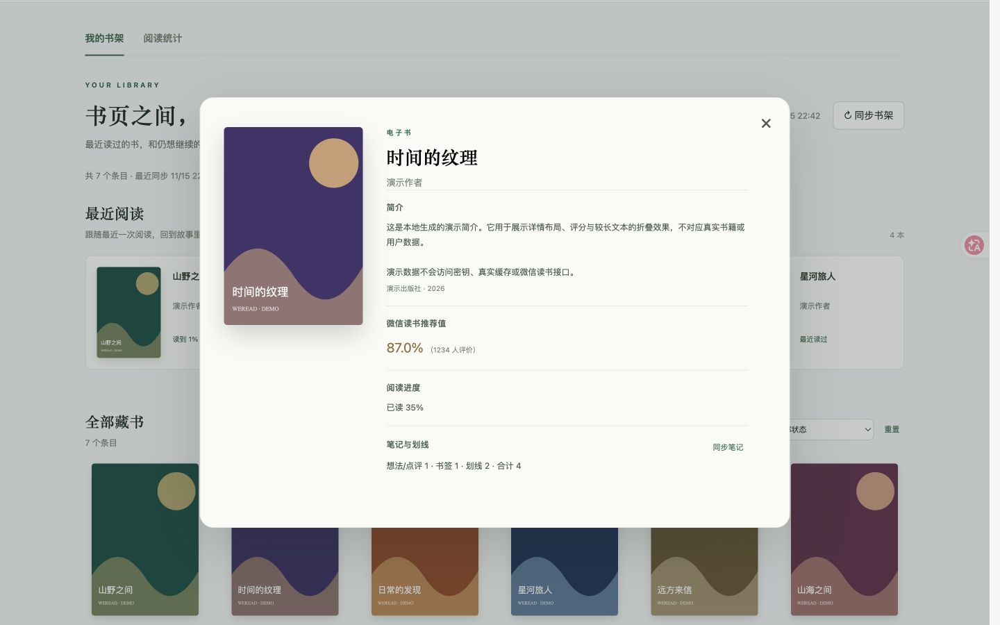

# 浮层开闭时的页面横向位移修复

日期：2026-11-15。基线：567b3dc；分支 feat/dynamic-bookshelf。状态：开发、独立测试与 root 视觉验收通过，等待用户体验验收；未推送、合并或部署。

问题：body 的 dialog-open 将 overflow 改为 hidden，使有宽度的页面滚动条消失，改变页面可用宽度。上一轮只检查详情外框加载稳定性，没有覆盖开闭时背景页面宽度。详情正文内部的 scrollbar-gutter 不会替页面保留右侧空间。

要求：

- 在真正的页面滚动容器 / viewport 预留滚动条槽，使打开前、打开后与关闭后的 main、标题、封面墙位置和宽度一致。优先最小 CSS 修复，不写死滚动条宽度，不重复叠加补偿。
- 保留浮层背景滚动锁、焦点和原滚动位置恢复，保留原有详情尺寸与动效。叠加式滚动条和手机不得新增多余空白。
- 不修改用户系统“始终显示滚动条”等设置。仅在独立的虚构数据诊断页通过定制滚动条创建有宽度滚动条环境；必须先测得打开前 innerWidth - root.clientWidth > 0，才能声称该场景验收通过。
- root 编写需求、复现和最终视觉确认；gpt-6-luna 分别开发与独立测试。agent 不提交，由 root 审查、验证并提交。

验收：同一诊断工具在基线先检出开闭横移，在新版对比 before/open/closed 全过程的 body、main/title/book-wall/brand rect 及 scrollY，同时记录 root.clientWidth。包含有宽度滚动条、默认滚动条、零宽模拟、390px 手机、页面滚动后打开、按钮/遮罩/Esc 关闭、重复开闭。保存虚构数据截图和测量摘要。不得只依据最终浮层截图或内部滚动区稳定就宣称整个页面稳定。

## 实现与实测

产品仅在根元素添加 `html{scrollbar-gutter:stable}`。浏览器根据实际滚动条宽度保留空间，body 锁滚动时不再改变背景页面布局宽度。没有固定像素补偿或额外 JavaScript 状态。

root 在真实 Chrome 中先复现基线，再使用相同探针验收修复。以下为打开前 → 打开期间 → 关闭后的测量；坐标单位为 CSS px，打开期间逐帧检查 main、标题、封面墙与品牌位置。完整摘要见 [测量证据](viewport-scrollbar-evidence.json)。

| 场景 | body 宽度 | main 左边缘 | scrollY |
| --- | --- | --- | --- |
| 基线 / 1440×900 / 16px 滚动条 | 1424 → 1440 → 1424 | 122 → 130 → 122 | 74 → 74 → 74 |
| 修复 / 同上 / Esc 关闭 | 1424 → 1424 → 1424 | 122 → 122 → 122 | 74 → 74 → 74 |
| 修复 / 同上 / 再次打开、遮罩关闭 | 1424 → 1424 → 1424 | 122 → 122 → 122 | 74 → 74 → 74 |
| 修复 / 默认 15px 滚动条 / 按钮关闭 | 1425 → 1425 → 1425 | 122.5 → 122.5 → 122.5 | 74 → 74 → 74 |
| 修复 / 1440×900 / 零宽模拟 | 1440 → 1440 → 1440 | 130 → 130 → 130 | 74 → 74 → 74 |
| 修复 / 390×844 / 零宽模拟 | 390 → 390 → 390 | 18 → 18 → 18 | 372.5 → 372.5 → 372.5 |

有宽度滚动条隐藏时，`root.clientWidth` 仍会变化；预留的布局槽让 body 和背景内容尺寸不变。因此不能只以 `innerWidth - root.clientWidth` 是否不变判定修复。16px 场景通过诊断页的定制滚动条创建，打开前实际测得 16px；默认 Chrome 在未注入滚动条 CSS 的基线页也测得 15px。零宽场景是诊断页 CSS 模拟，不代表操作系统叠加式滚动条实机验收；未修改系统设置。

root 亲自查看桌面开闭与手机画面。手机详情边界 x=16…374，页面 scrollWidth=390，没有横向溢出；浮层外滚轮操作未改变背景 scrollY=372.5，关闭后焦点回到原书卡片。普通演示服务也已打开详情确认。

## 检查与重现

Python 34 项通过；app.js、shelf.js 语法检查通过；frontend、shelf_frontend、detail_motion 三份前端检查通过；诊断服务编译和 `git diff --check` 通过。远端 CI 未运行。

```sh
# 基线先复现，随后不带 baseline-ref 验收工作区修复
python3 tests/detail_visual_server.py --port 8777 --classic-scrollbar --baseline-ref 567b3dc
python3 tests/detail_visual_server.py --port 8777 --classic-scrollbar
# 零宽布局模拟（与 classic-scrollbar 互斥），手机视口在浏览器中设为 390×844
python3 tests/detail_visual_server.py --port 8777 --zero-scrollbar --long-title --long-intro
```

每条命令独立运行，先停止上一实例再启动下一条。点书前一帧、打开期间最多 6 秒与关闭后 1.5 秒的采样保存在页面隐藏的 `#detail-visual-samples` 中。诊断工具只用虚构数据，不访问密钥、私有缓存或上游接口。验收用临时诊断服务已停止；普通演示预览 http://127.0.0.1:8877 与真实书架 http://127.0.0.1:8878 保留，刷新后体验。


